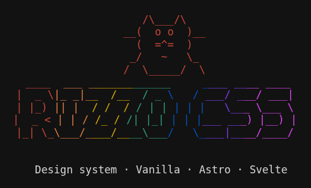

# Rizzo CSS

<div align="center">

<p align="center">
  
</p>

*Run `npx rizzo-css help` to see this in the CLI (the rainbow uses our theme colors).*

<!-- Generated by `pnpm readme:tech` from the installed versions. Do not edit between the markers. -->
<!-- tech-badges:start -->
<p align="center">
  <a href="https://www.npmjs.com/package/rizzo-css"></a>
  <a href="./LICENSE"></a>
  <a href="https://github.com/mingleusa/rizzo-css/actions/workflows/a11y.yml"></a>
</p>

<p align="center">
  <a href="https://astro.build"></a>
  <a href="https://svelte.dev"></a>
  <a href="https://react.dev"></a>
  <a href="https://vuejs.org"></a>
</p>

<p align="center">
  <a href="https://www.typescriptlang.org"></a>
  <a href="https://vite.dev"></a>
  <a href="https://postcss.org"></a>
  <a href="https://stylelint.io"></a>
  <a href="https://typicode.github.io/husky/"></a>
  <a href="https://nodejs.org"></a>
  <a href="https://pnpm.io"></a>
</p>

<p align="center">
  <a href="https://playwright.dev"></a>
  <a href="https://github.com/dequelabs/axe-core"></a>
  <a href="https://storybook.js.org"></a>
</p>

<p align="center">
  <a href="https://www.algolia.com"></a>
</p>
<!-- tech-badges:end -->

A modern CSS design system with semantic theming and **58 accessible components**. **Vanilla**, **Astro**, **Svelte**, **React** and **Vue**: the same CSS and BEM naming everywhere, with docs and a CLI for all five.

[Quick start](#-quick-start) • [Tech stack](#-tech-stack) • [Development](#-development) • [Documentation](#-documentation) • [Live site](https://rizzo-css.vercel.app)

</div>

---

## ✨ Features

- 🎨 **14 built-in themes**: 7 dark and 7 light, with semantic variables and an OS-following **System** option
- ♿ **Accessibility first**: WCAG AA contrast, full keyboard navigation, screen reader support, and automated axe, keyboard and ARIA tests across Chromium, Firefox and WebKit
- 🎯 **Semantic theming**: components read semantic CSS variables, so they adapt to any theme automatically
- 📦 **58 components + 6 blocks**: each documented with a live demo and copy-paste code for Astro, Vanilla, Svelte, Vue and React. Importable components exist for all five (see [Framework support](#framework-support))
- 🔀 **Five frameworks, one stylesheet**: the same CSS and BEM classes for Vanilla JS, Astro, Svelte, React and Vue
- 🧰 **CLI**: scaffold a new project or add Rizzo to an existing one, in any of the five frameworks
- 🌈 **OKLCH colors**: perceptually uniform color space for themes and tokens
- 🌍 **RTL support**: logical spacing utilities and `dir="rtl"` tested
- 🛠️ **Utility classes**: display, position, borders, flexbox, grid, gap, animation and more
- 📱 **Responsive**: mobile-first with shared breakpoints
- 🎯 **Design tokens as the source of truth**: 280+ CSS variables, also exported as JSON/JS for tooling ([tokens reference](https://rizzo-css.vercel.app/docs/tokens))
- ⚡ **Small**: one PostCSS-built stylesheet, ~305 kB minified / ~45 kB gzipped, with a 450 kB CI budget

## 🚀 Quick start

```bash
npx rizzo-css init        # or: pnpm dlx rizzo-css init
```

Pick a **framework**, then **create new** or **add to existing**. Both flows use the same **template** choice:

| Template | You get |
|----------|---------|
| **CSS only** | Stylesheet, license, README, `.gitignore`. No pages or components |
| **Landing** | Hero and features page |
| **Docs** | Sidebar layout with a sample doc |
| **Dashboard** | Sidebar with stats and a table |
| **Full** | A clone of the docs site |

Landing, Docs and Dashboard then offer a component picker (everything, or choose). The CLI never overwrites existing files; anything it skips is written to `RIZZO-SETUP.md`.

### Framework support

| Framework | Docs and live demos | Importable components (what `init`/`add` install) | Scaffold |
|-----------|---------------------|---------------------------------------------------|----------|
| **Vanilla** | All 58 | HTML pages + optional JS (`--vanilla-js`) | Static HTML |
| **Astro** | All 58 | All | Astro |
| **Svelte** | All 58 | All (Svelte 5) | SvelteKit 3 |
| **React** | All 58 | All (TSX) | Vite |
| **Vue** | All 58 | All (Vue 3, `<script setup>`) | Vite |

Vue's importable components are tested end to end: `pnpm test:vue-scaffold` generates a project with the real CLI, type-checks and builds it, and exercises every interactive component in a browser (see [TESTING](./docs/TESTING.md#7-vue-scaffold-end-to-end)).

Non-interactive:

```bash
npx rizzo-css init --yes --framework astro --template landing
npx rizzo-css add --template css-only
```

| Command | Purpose |
|---------|---------|
| `init` | Create a project, or add Rizzo to an existing one |
| `add` | Add components (or CSS only) to an existing project. Supports `--dry-run` |
| `theme` | Choose the default light/dark themes |
| `doctor` | Check config, the CSS file and the layout link |
| `help` | Usage, flags and `help components` for the component list |

You can also install the package and link the stylesheet yourself:

```bash
pnpm add rizzo-css
```

```html
<link rel="stylesheet" href="/css/rizzo.min.css" />
```

**What ships in the npm package:** `dist/` (CSS, fonts, sounds), the CLI, and scaffolds for Vanilla, Astro (base + variants), Svelte (base + variants), React and Vue. Every scaffold includes `LICENSE-RIZZO`, `README-RIZZO.md` and a `.gitignore`. CDN: pin a version, e.g. `https://cdn.jsdelivr.net/npm/rizzo-css@<version>/dist/rizzo.min.css`.

Full guide: [Getting Started](./docs/GETTING_STARTED.md) · CLI reference: [CLI](./docs/CLI.md).

## 🛠️ Tech stack

Versions below are generated from what is installed (`pnpm readme:tech`), so they track `package.json` and the lockfile.

<!-- tech-stack:start -->
| Area | Tool | Version | Role |
|------|------|---------|------|
| Frameworks | [Astro](https://astro.build) | `7.3` | Docs site and reference components; React/Vue/Svelte islands via official integrations |
| Frameworks | [Svelte](https://svelte.dev) | `5.57` | Components and docs at `/docs/svelte`; SvelteKit scaffold |
| Frameworks | [React](https://react.dev) | `19.3` | Components and docs at `/docs/react`; Vite scaffold |
| Frameworks | [Vue](https://vuejs.org) | `3.5` | Components and docs at `/docs/vue`; Vite scaffold |
| Build & tooling | [TypeScript](https://www.typescriptlang.org) | `6.0` | Type safety |
| Build & tooling | [Vite](https://vite.dev) | `8` | Bundler under Astro; Vite scaffolds for Svelte, React and Vue |
| Build & tooling | [PostCSS](https://postcss.org) | `8.5` | CSS pipeline: postcss-import, Autoprefixer, cssnano |
| Build & tooling | [Stylelint](https://stylelint.io) | `17` | CSS linting |
| Build & tooling | [Husky](https://typicode.github.io/husky/) | `9` | Git hooks: pre-commit runs lint-staged; pre-push runs build + smoke tests |
| Build & tooling | [Node.js](https://nodejs.org) | `22.22.3+` | Required to build this repo (Astro 7, cssnano 9); the published CLI supports Node 18+ |
| Build & tooling | [pnpm](https://pnpm.io) | `12.11` | Package manager (`packageManager` field) |
| Quality | [Playwright](https://playwright.dev) | `1.64` | Smoke, accessibility and visual regression tests |
| Quality | [axe-core](https://github.com/dequelabs/axe-core) | `4.13` | Accessibility rules (via @axe-core/playwright) |
| Quality | [Storybook](https://storybook.js.org) | `10` | React component playground (optional) |
| Services | [Algolia](https://www.algolia.com) | `5` | Docs-site search (optional) |
<!-- tech-stack:end -->

Also: [OKLCH](https://oklch.com) colors for themes ([culori](https://culorijs.org) generates the format variants), [Style Dictionary](https://styledictionary.com) for token export, and BEM naming for every component.

## 💻 Development

**Prerequisites:** Node.js 22.22.3+ (or 24.15+) and [pnpm](https://pnpm.io). Astro 7 and cssnano 9 need a recent Node; the published CLI itself runs on Node 18+.

```bash
pnpm install
pnpm dev          # http://localhost:4321
```

### Commands

| Command | Description |
|---------|-------------|
| `pnpm dev` / `pnpm preview` | Dev server / preview the production build |
| `pnpm build` | Generate color formats and tokens, lint and build the CSS, then build the docs site |
| `pnpm build:css` | Build only the minified CSS → `public/css/main.min.css` and `packages/rizzo-css/dist/rizzo.min.css` |
| `pnpm build:package` | Full package prep: lint, CSS, copy scaffolds, prepare the Vanilla scaffold |
| `pnpm publish:package` | Build and publish the `rizzo-css` npm package ([PUBLISHING](./docs/PUBLISHING.md)) |
| `pnpm rizzo-css <cmd>` | Run the CLI from this repo (elsewhere use `npx rizzo-css`) |
| `pnpm lint:css` / `pnpm lint:css:fix` | Stylelint the CSS |
| `pnpm check:svelte` | Type-check the Svelte components (`svelte-check`, scoped config) |
| `pnpm check:size` | Build the CSS and fail if it exceeds the 450 kB budget |
| `pnpm check:contrast` | Verify WCAG AA contrast for all 14 themes |
| `pnpm export:tokens` | Export design tokens to `public/tokens/` (runs as part of `build`) |
| `pnpm readme:tech` | Regenerate the README tech badges and stack table |
| `pnpm storybook` / `pnpm build-storybook` | React component playground ([STORYBOOK](./docs/STORYBOOK.md)) |

### Tests

| Command | Covers |
|---------|--------|
| `pnpm test:smoke` | Key routes load (home, docs, blocks, themes, React/Vue indexes). The pre-push hook runs this |
| `pnpm test:a11y` | axe, keyboard and ARIA tests on all docs routes (`:fast` for a subset, `:ci:cross-browser` for Chromium + Firefox + WebKit) |
| `pnpm test:visual` | Screenshot regression of key routes (`test:visual:update` refreshes baselines locally) |
| `pnpm test:storybook` | Storybook interaction and a11y tests for the React components |

Run `pnpm exec playwright install` once before the browser tests. CI ([`a11y.yml`](./.github/workflows/a11y.yml)) runs the dependency audit, build, size budget, accessibility on three browsers, and visual regression on a pinned `ubuntu-24.04` runner. Visual baselines should be generated on that runner: **Actions → Accessibility (a11y) → Run workflow → `update_snapshots`**, then commit the uploaded `visual-snapshots` artifact. Details: [TESTING](./docs/TESTING.md).

### Project structure

```text
src/
  components/      astro/ svelte/ react/ vue/ + shared icons, docs helpers
  config/          nav, component lists, themes, code snippets per framework
  layouts/ pages/  the docs site (Astro)
  styles/          CSS source: variables, reset, base, components, themes, utilities
  stories/         Storybook stories (React)
packages/rizzo-css/
  bin/             the CLI
  scaffold/        templates copied into user projects (astro, svelte, react, vue, vanilla)
scripts/           build, token export, scaffold copy, README generator
tests/             smoke, a11y (axe/keyboard/ARIA) and visual specs
docs/              guides (see Documentation below)
ai/ public/        LLM metadata (llms.txt/json) and design tokens
```

## 🎨 CSS setup

CSS is authored as modules imported by `src/styles/main.css` (PostCSS `@import`): variables, reset, base, typography, accessibility, components, themes, utilities and more.

```css
@import url('./variables.css');
@import url('./reset.css');
@import url('./base.css');
/* ... */
```

- **Development:** PostCSS resolves imports and adds vendor prefixes; all 14 themes are available.
- **Production:** `build:css` minifies (cssnano), and the layout uses `public/css/main.min.css`.
- **Architecture:** every component uses **BEM** (`.navbar`, `.navbar__container`, `.navbar__menu--open`). See [Design System](./docs/DESIGN_SYSTEM.md) for the file list and variable reference.

## 🌗 Theming

**14 built-in themes** (7 dark, 7 light), all using OKLCH and semantic variables:

- Components adapt automatically, with **contrast-aware text colors** for WCAG AA
- First visit follows the OS (`prefers-color-scheme`); the **System** option keeps following it
- Each theme has its own icon in the theme switcher
- The Settings panel (theme, font pair, font size, reduced motion, high contrast, scrollbar style) **persists in `localStorage`**
- Shadow and overlay variables are theme-aware

See [Theming](./docs/THEMING.md) and [Colors](./docs/COLORS.md).

## 🧩 Components and blocks

58 accessible, themeable components, documented by category with live examples and code for every framework:

| Category | Components |
|----------|------------|
| Layout | Navbar, Docs Sidebar, Dashboard, Resizable, Footer |
| Forms & inputs | Button, Button Group, Forms (Input, Textarea, Select, Checkbox, Radio), Input Group, Input OTP, Switch, Slider, Toggle, Toggle Group, Divider, Separator, Label, Kbd |
| Data display | Cards, Carousel, Chart, Table, Badge, Pagination, Aspect Ratio, Empty, Scroll Area, Calendar, Range Calendar |
| Feedback | Alert, Skeleton, Spinner, Progress Bar, Toast |
| Overlay | Modal, Alert Dialog, Sheet, Popover, Hover Card, Context Menu, Command, Dropdown, Tooltip |
| Navigation | Breadcrumb, Back to Top |
| Disclosure | Accordion, Collapsible, Tabs |
| Other | Avatar, Copy to Clipboard, Direction, Theme Switcher, Font Switcher, Settings, Search (Algolia), Icons, Sound Effects |

**Blocks:** Landing hero, Pricing, Dashboard with sidebar, Docs layout, Login, Sign up.

All components use semantic variables, follow BEM, are keyboard accessible, meet WCAG AA contrast, and use no inline styles. Browse them in [COMPONENTS](./docs/COMPONENTS.md) or at [rizzo-css.vercel.app](https://rizzo-css.vercel.app/docs/components).

## 📚 Documentation

**Live site:** [rizzo-css.vercel.app](https://rizzo-css.vercel.app). The `docs/` directory has the long-form guides; the full index is [docs/README.md](./docs/README.md).

| Guide | What it covers |
|-------|----------------|
| [Getting Started](./docs/GETTING_STARTED.md) | CLI, install, importing the CSS, using components in each framework |
| [CLI](./docs/CLI.md) · [Templates](./docs/TEMPLATES.md) | Commands, flags, and what each template generates |
| [Design System](./docs/DESIGN_SYSTEM.md) · [Colors](./docs/COLORS.md) · [Theming](./docs/THEMING.md) | Variables, utilities, color formats, themes |
| [Components](./docs/COMPONENTS.md) | The 58 components and their usage |
| [Accessibility](./docs/ACCESSIBILITY.md) · [Best Practices](./docs/BEST_PRACTICES.md) · [RTL](./docs/RTL.md) · [Browser Support](./docs/BROWSER_SUPPORT.md) | Guidelines, manual testing, RTL, supported browsers |
| [Multi-Framework](./docs/MULTI_FRAMEWORK.md) · [Framework Structure](./docs/FRAMEWORK_STRUCTURE.md) | How the five frameworks share one stylesheet |
| [Testing](./docs/TESTING.md) · [Storybook](./docs/STORYBOOK.md) | Smoke, a11y, visual and Storybook tests |
| [Publishing](./docs/PUBLISHING.md) · [Maintaining](./docs/MAINTAINING.md) · [Upgrade](./docs/UPGRADE.md) | Release process, maintenance, dependency roadmap |
| [Changelog](./CHANGELOG.md) · [TODO](./docs/TODO.md) · [Contributing](./CONTRIBUTING.md) | Releases, roadmap, how to contribute |

## 🤝 Contributing and releases

Read [CONTRIBUTING](./CONTRIBUTING.md) first. In short: run `pnpm build`, `pnpm test:smoke` and `pnpm test:a11y` before opening a PR, keep the CSS under the size budget, and add the component to every framework when you add one. Releases follow [PUBLISHING](./docs/PUBLISHING.md).

## 📄 License

[MIT](./LICENSE)

## 🔗 External resources

[Astro](https://docs.astro.build) · [PostCSS](https://postcss.org/docs) · [Stylelint](https://stylelint.io/user-guide) · [Playwright](https://playwright.dev/docs/intro) · [axe-core](https://github.com/dequelabs/axe-core)
